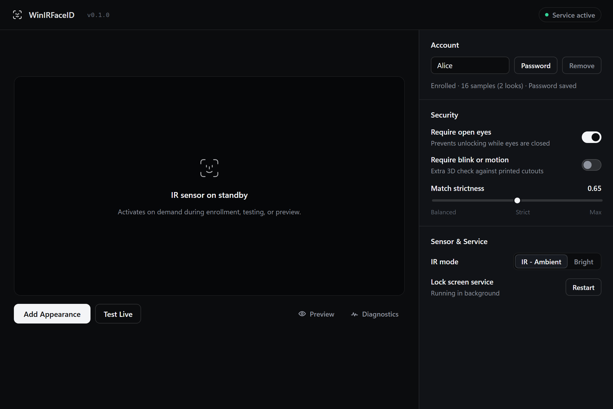
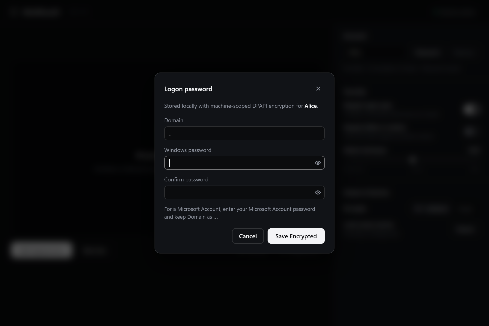

<div align="center">
  
  <h1>WinIRFaceID</h1>
  <p><strong>Pure-infrared facial recognition and native Windows 11 lock screen sign-in — built to work in total darkness.</strong></p>
  <p>
    <code>Windows 11 x64</code> · <code>Pure 850nm IR</code> · <code>Local-Only DPAPI</code> · <code>Additive Credential Provider</code>
  </p>
</div>

<p align="center">
  
</p>

## Why This Exists

After Microsoft's **CVE-2025-26644** mitigation on Windows 11, native Windows Hello Face requires the color (RGB) camera to see your face alongside the infrared sensor. In dark rooms or dim lighting, face unlock fails even though the laptop has a dedicated hardware 850nm IR flood illuminator.

**WinIRFaceID** bypasses the RGB requirement completely. It captures directly from the hardware IR sensor through WinRT `MediaCapture`, drives the IR flood LED via direct kernel streaming `IOCTL_KS_PROPERTY` (`KSPROPERTY_CAMERACONTROL_EXTENDED_FACEAUTH_MODE = ALTERNATIVE_FRAME_ILLUMINATION`), and computes active `IR - Ambient` difference frames with **zero RGB camera dependency**.

---

## Security & Anti-Spoofing

WinIRFaceID is designed to be auditable, isolated, and safe to run on a daily-driver Windows 11 machine.

- **100% Local & Offline:** No cloud services and no telemetry. The release installer bundles its own Python runtime, all dependency wheels, and the two OpenCV Zoo ONNX models (`YuNet` + `SFace`, SHA-256 pinned), so installing needs no network access at all. The only outbound call is checking GitHub Releases for lightweight (~350 KB) SHA-256-verified delta updates (on startup or via the version pill).
- **Strict IR-Only Pipeline:** Enrollment and verification refuse non-IR cameras and never fall back to an RGB webcam.
- **Multi-Layer Physical 3D IR Anti-Spoofing:**
  1. **Active IR Illuminator Delta (`IR - Ambient`):** Subtracts ambient dark frames from LED-illuminated frames. OLED and LCD phone or tablet screens emit visible light rather than reflected 850nm IR, yielding near-zero delta and immediate rejection.
  2. **Auto-Exposure Settling Guard:** Discards overexposed startup frames while the IR sensor's auto-exposure converges.
  3. **Minimum Face Size, `1/r²` Background Falloff & 3D Facial Relief:** Evaluates active-IR intensity drop-off between the central face and surrounding background bands, plus center-vs-upper-corner 3D relief across the face bounding box, rejecting flat polycarbonate ID cards, photos, and printed cutouts held up to the camera.
  4. **Open-Eyes Gate (Optional):** Compares IR eye-region reflectance against skin reflectance (`Require open eyes`) to prevent unlocking while asleep.
  5. **Temporal Liveness (Optional):** Verifies a natural blink dip or 3D nose-to-eye parallax over a short sliding window (`Require blink or motion`) when extra anti-cutout protection is desired.
- **Process Isolation (`LogonUI.exe` Hygiene):** `WinIRFaceIDProvider.dll` is a thin C++17 COM DLL that performs zero camera access and zero ML inference inside `LogonUI.exe`. All capture, anti-spoofing, and embedding matching run in the isolated `WinIRFaceIDService` (`LocalSystem`) over a secured Named Pipe (`\\.\pipe\WinIRFaceID`) using overlapped I/O (`CancelIoEx`) and `SecureZeroMemory` credential wiping.
- **Encrypted At Rest:** Face embeddings (`128-D` SFace vectors) and Windows logon passwords are encrypted with machine-scoped Windows DPAPI (`CRYPTPROTECT_LOCAL_MACHINE`) inside `data\profiles.enc`, protected by a hardened NTFS DACL permitting only `SYSTEM` and `Administrators`. On machines with TPM 2.0 the logon password is additionally wrapped with a non-exportable TPM key, so a copied `profiles.enc` is useless off the machine. The saved password is checked with `LogonUser` before it is stored.
- **Per-User Self-Service:** The desktop app never touches `profiles.enc` directly; it manages *your own* profile through the service, which binds every request to the caller's Windows identity. One user cannot read or overwrite another user's face data or password, and passwords are never sent back over the pipe.
- **No User-Writable Code Runs as SYSTEM:** The service runs from `Program Files\WinIRFaceID` on a private Python runtime (`runtime\python`, official PSF-signed CPython) instead of any per-user Python install, so non-administrators cannot inject code into the `LocalSystem` process.
- **Strictly Additive Lock Screen Integration:** Does not implement `ICredentialProviderFilter` and never disables Windows Hello PIN, Fingerprint, or Password.

> [!IMPORTANT]
> **Physical Security (BitLocker & Account Password):** While TPM 2.0, machine-scoped DPAPI, and hardened NTFS ACLs protect stored credentials while Windows is running, **full-disk encryption (BitLocker or Windows Device Encryption on `C:`)** is the only real defense against an attacker with physical access who boots another OS from USB to inspect or tamper with the drive offline. The WinIRFaceID desktop app automatically checks drive `C:` and warns you if BitLocker or Device Encryption is off or suspended. Because WinIRFaceID stores your Windows logon password locally to unlock your session, use a dedicated Windows logon password (or a distinct local account password) rather than reusing a high-value online password.

---

## Features & UX Highlights

- **Native Windows 11 Lock Screen Integration:** Implements `ICredentialProviderCredential3::GetBitmapBufferValue` for alpha-transparent white Fluent icons on both the sign-in options tile and the selected hero tile. On `Win + L`, background IR scanning starts automatically even while PIN or Fingerprint is selected, and cancels immediately if you sign in another way.
- **Local & Microsoft Account Support:** Works with local Windows accounts (`Domain = .`) and Microsoft Accounts (`MicrosoftAccount\...` resolved automatically from your Windows account password).
- **Guided Enrollment:** Enrollment walks you through 7 head poses (center, left, right, relaxed, chin up, chin down, back to center) with an animated pose guide and a hold-still ring; a sample is only captured after your face has been steady and live for a moment.
- **Alternate Appearances (Glasses, Beard, Lighting):** Clicking **Add Appearance** enrolls another look (7 more IR captures, up to 32 samples per user) so recognition stays reliable both with and without prescription glasses. Each look is listed under **Account** with its date and can be deleted individually. *(Near-IR passes through most clear prescription lenses; IR-blocking sunglasses will block 850nm light.)*
- **Minimalist Edge WebView2 Desktop App:** Keeps the IR camera and flood LED on standby until you actively start enrollment, live testing, or preview. Includes live SVG corner-bracket face tracking, a collapsible monospace IR diagnostics strip (`IR Δ`, `BG`, `3D`, `Eyes`), live match scores, and 1-click SHA-256-verified delta updates (~350 KB) from GitHub Releases. Security settings (match strictness 0.60–0.80, liveness options) apply to the service immediately — no restart needed.

<details>
<summary>Screenshot: Local-only DPAPI Logon Password modal</summary>
<br>
<p align="center">
  
</p>
</details>

---

## Architecture

```text
win-ir-faceid/
├── engine/
│   ├── ir_camera.py          # WinRT MediaCapture + IOCTL_KS_PROPERTY IR LED control & bright/dark pairing
│   ├── models.py             # OpenCV Zoo YuNet (detection) & SFace (128-D embedding) downloader
│   ├── recognizer.py         # Strict IR YuNet detection (0.78) & SFace cosine matching (0.65 default)
│   ├── liveness.py           # Active IR delta, AE guard, 1/r² background falloff, 3D relief, open eyes, temporal liveness
│   ├── store.py              # DPAPI-encrypted profile store + hardened NTFS DACL + service_config.json
│   ├── ipc_server.py         # LocalSystem Named Pipe server (\\.\pipe\WinIRFaceID)
│   ├── gui_app.py            # Edge WebView2 desktop controller & loopback MJPEG server
│   ├── ui/                   # Minimalist dark HTML/CSS/JS frontend & app.ico
│   └── cli.py                # CLI entry points (gui, download-models, enroll, verify, serve, migrate-store)
├── credential_provider/
│   ├── provider.cpp / .h     # ICredentialProvider / ICredentialProviderSetUserArray (additive V2 provider)
│   ├── credential.cpp / .h   # ICredentialProviderCredential3 (Fluent alpha icon, background scan, Kerberos unlock)
│   ├── pipe_client.cpp / .h  # Overlapped Win32 Named Pipe client with CancelIoEx cancellation
│   ├── service_host.cpp      # LocalSystem Windows Service supervisor (WinIRFaceIDService.exe)
│   ├── pipe_client_test.cpp  # Standalone Named Pipe verification CLI (ping / verify)
│   ├── install.ps1 / uninstall.ps1
│   └── CMakeLists.txt
├── scripts/
│   ├── setup.ps1             # One-click installer (private Python runtime, venv, ACLs, models, service & DLL)
│   ├── python_runtime.ps1    # Installs & verifies the private PSF-signed CPython 3.11 runtime
│   ├── install_service.ps1   # Migrates store to machine DPAPI, installs & verifies WinIRFaceIDService
│   ├── uninstall_service.ps1 # Stops & removes WinIRFaceIDService
│   ├── create_shortcut.ps1   # Creates Start Menu (and optional -Desktop / -AllUsers) shortcut
│   └── build_release.ps1     # Stages runtime + wheels + models, packages ZIP, Inno Setup EXE, SHA256SUMS.txt
├── installer/
│   └── WinIRFaceID.iss       # Inno Setup 6 native Windows x64 wizard installer script
├── tools/
│   └── ir_camera_tester/     # Standalone IR/RGB diagnostic tool with illuminator toggle & recording
├── docs/
│   ├── IPC_PROTOCOL.md       # Named Pipe JSON protocol specification
│   └── screenshots/          # Desktop UI screenshots & app icon
├── Install.bat               # Double-click self-elevating setup launcher
├── Uninstall.bat             # Double-click self-elevating uninstaller
└── launch_gui.bat            # Launches the desktop GUI
```

---

## Requirements

- **OS:** Windows 11 x64 with a Windows Hello IR camera (hardware IR sensor + 850nm illuminator)
- **Runtime:** Microsoft Edge WebView2 Runtime (pre-installed on Windows 11)
- **Python:** none needed — setup installs a private CPython 3.11 x64 into `Program Files\WinIRFaceID
untime\python` (bundled in releases; downloaded from the official python.org NuGet package for source installs). Your own Python installs are never used or modified. *(Developing from source still needs a Python 3.11 x64 of your own for the dev `.venv`.)*
- **Build Tools (Source Build only):** Visual Studio 2022 / 2026 (Desktop development with C++ + CMake) to compile the C++ Credential Provider and Service Host

---

## Installation & Setup

### Option 1: Plug & Play Installer (Recommended)

Zero Visual Studio, CMake, or manual Python steps required — download from [GitHub Releases](https://github.com/al3ksh/win-ir-faceid/releases):

- **Wizard Installer (`WinIRFaceID-Setup-vX.Y.Z-x64.exe`):** Run the installer and follow the setup wizard. It installs into `Program Files\WinIRFaceID` with its own bundled Python runtime, dependencies, and ONNX models (works fully offline), sets up `.venv`, installs `WinIRFaceIDService`, registers the lock screen Credential Provider, creates your Start Menu shortcut, and offers to launch **WinIRFaceID**. Setup runs in the background with a progress indicator; if any step fails, the wizard tells you and the full log is in `Program Files\WinIRFaceID\setup.log`. Upgrading over an older version replaces a venv that was built on a per-user Python.
- **Portable Release ZIP (`WinIRFaceID-vX.Y.Z-win64.zip`):** Extract the archive to a permanent folder and double-click **`Install.bat`** (requests Administrator UAC once, copies itself into `Program Files\WinIRFaceID`, and configures everything automatically).

> [!NOTE]
> **Windows SmartScreen:** `WinIRFaceID-Setup-vX.Y.Z-x64.exe` is an unsigned open-source binary compiled transparently by GitHub Actions (without a paid EV code-signing certificate), so Windows Defender SmartScreen will show **"Windows protected your PC"**. Click **More info → Run anyway** to run the installer. You can also verify your download against `SHA256SUMS.txt`, inspect [`.github/workflows/release.yml`](.github/workflows/release.yml), or build from source in [Option 2](#option-2-build-from-source-developers).

Once the **WinIRFaceID** desktop window opens:
1. Verify your Windows username is filled in under **Account** and click **Enroll Face** (7 guided active-IR captures). If you wear glasses, click **Add Appearance** afterwards to enroll an additional look with glasses on.
2. Click **Password** and save your Windows logon password (encrypted locally via DPAPI). For a Microsoft Account, enter your Microsoft Account password and keep **Domain** set to `.`.
3. Click **Test Live** to verify active-IR detection, anti-spoofing, and match score.
4. Press **`Win + L`** to lock your workstation and test pure-IR unlock (keep Windows Hello PIN or Password enabled as your fallback).

### Option 2: Build from Source (Developers)

#### 1. Clone & Install Python Dependencies

```powershell
git clone https://github.com/al3ksh/win-ir-faceid.git
cd win-ir-faceid

python -m venv .venv
.\.venv\Scripts\Activate.ps1
pip install -r requirements.txt
```

*(Tip: After cloning, you can also double-click `Install.bat` or run `.\scripts\setup.ps1` as Administrator — it copies the app into `Program Files\WinIRFaceID`, downloads the private Python runtime, and, if CMake and Visual Studio Build Tools are on `PATH`, builds the C++ targets and completes the full setup automatically.)*

#### 2. Launch the App, Download Models & Enroll Your Face

Launch the desktop app via `launch_gui.bat` (or create a Start Menu shortcut first):

```powershell
.\scripts\create_shortcut.ps1
.\launch_gui.bat
```

Inside the **WinIRFaceID** window:
1. Click **Download Models** if prompted (fetches YuNet and SFace ONNX weights into `models/`, ~37 MB total; or run `python -m engine.cli download-models`).
2. Verify your Windows username is filled in under **Account** and click **Enroll Face** (7 guided active-IR captures). If you wear glasses, click **Add Appearance** afterwards to enroll an additional look with glasses on.
3. Click **Password** and save your Windows logon password (encrypted locally via DPAPI). For a Microsoft Account, enter your Microsoft Account password and keep **Domain** set to `.`.
4. Click **Test Live** to verify active-IR detection, anti-spoofing, and match score before enabling lock screen integration.

#### 3. Build the C++ Credential Provider & Service Host (`x64 Release`)

```powershell
cmake -S credential_provider -B credential_provider/build -A x64
cmake --build credential_provider/build --config Release
```

*(If `cmake` on your `PATH` defaults to Ninja instead of Visual Studio, pass `-G "Visual Studio 17 2022" -A x64` or invoke Visual Studio's bundled `cmake.exe` — see [credential_provider/README.md](credential_provider/README.md).)*

This produces:
- `credential_provider\build\Release\WinIRFaceIDProvider.dll`
- `credential_provider\build\Release\WinIRFaceIDService.exe`
- `credential_provider\build\Release\pipe_client_test.exe`

#### 4. Install & Verify `WinIRFaceIDService` (Administrator PowerShell)

Run the following from an **elevated (Administrator) PowerShell** prompt at the repository root:

```powershell
.\scripts\install_service.ps1
.\credential_provider\build\Release\pipe_client_test.exe verify <your-windows-username>
```

`install_service.ps1` migrates `data\profiles.enc` to machine-scoped DPAPI with a hardened NTFS DACL, installs `WinIRFaceIDService` as `LocalSystem`, starts it, and runs `pipe_client_test.exe ping`. Confirm `pipe_client_test.exe verify <your-windows-username>` matches your face cleanly before registering the lock screen DLL.

#### 5. Register the Credential Provider (Administrator PowerShell)

Still in an **elevated PowerShell** prompt (keep Windows Hello PIN or Password enabled as your fallback):

```powershell
cd credential_provider
.\install.ps1
```

Press **`Win + L`** to lock your workstation and test pure-IR unlock.

---

## Development & Tests

```powershell
.\.venv\Scripts\pytest.exe -v
```

---

## Troubleshooting

| Symptom | Likely Cause | Fix |
| :--- | :--- | :--- |
| **No IR camera detected / IR LED doesn't pulse** | Device lacks a Windows Hello IR sensor, driver is disabled, or a physical privacy shutter is closed. | Open **Device Manager -> Cameras** and confirm the IR sensor is enabled, open any camera privacy shutter, and update your laptop's OEM camera/IR driver. Run `tools\ir_camera_tester\run.bat` to inspect detected sensors and test the illuminator directly, then click **Rescan Cameras** in the app. |
| **Camera access denied or in use** | Windows camera privacy blocks desktop apps (`0x80070005`), or another app holds exclusive sensor access (`0xC00D3704` / `0xC00DABE0`). | In **Windows Settings -> Privacy & security -> Camera**, enable **Camera access** and **Let desktop apps access your camera**. Close the Windows Camera app, Zoom/Teams, or **Windows Hello Face** settings, then click **Retry**. |
| **Installer reports that the final setup step failed** | A download (source installs only), antivirus blocking PowerShell, or the service failing its health check. | Open `C:\Program Files\WinIRFaceID\setup.log` — the last lines show the failing step. Fix the cause and run the installer again (it is safe to re-run). |
| **Lock screen says `WinIRFaceID service is offline` or `pipe_client_test` fails (Win32 error 2 / 5)** | `WinIRFaceIDService` is stopped, not installed, or its named pipe ACL/process crashed. | Check `Get-Service WinIRFaceIDService` and inspect `data\service.log`. Re-run `.\scripts\install_service.ps1` from an **Administrator PowerShell** prompt to reinstall and verify the service. |
| **Face matches in `pipe_client_test` but lock screen rejects password (Microsoft Account)** | A Windows Hello PIN or wrong domain was saved instead of the full Microsoft Account password. | Open **Password** in the desktop app, enter your actual **Microsoft Account password** (not your PIN), and keep **Domain** set to `.`. |
| **Low match score / fails with glasses or in different lighting** | Enrolled embeddings only cover one appearance or lighting geometry. | Click **Add Appearance** in the desktop app to enroll an alternate look with glasses on, or adjust **Match strictness** slightly in **Security**. |
| **Blocked as `Flat surface` / `Screen detected` / `Eyes closed`** | Face is too far/off-axis, ambient IR overwhelms the illuminator, or eyelids obscure IR pupil contrast. | Enable **Diagnostics** in the desktop app to inspect live `IR Δ`, `BG`, `3D`, and `Eyes` telemetry. Center your face roughly 40–65 cm from the sensor with eyes open; toggle **Require open eyes** only if needed for glasses glare. |

---

## Clean Uninstall & Safe Mode Recovery

- **Wizard Installer:** Uninstall **WinIRFaceID** from **Windows Settings -> Apps -> Installed apps**. This unregisters the Credential Provider, removes `WinIRFaceIDService`, and cleans up `.venv`, the private Python `runtime`, and `models`. It then asks whether to **also delete your face profiles and stored Windows password**: **Yes** deletes the TPM password key and the whole `data\` folder; **No** keeps `data\` for a later reinstall. Silent uninstalls (`/SILENT`) keep the data.
- **Remove only the lock screen tile** (keep the app and service) from an **Administrator PowerShell** prompt:

```powershell
& "C:\Program Files\WinIRFaceID\credential_provider\uninstall.ps1"
```

- **Portable ZIP / Source Clone:** Double-click **`Uninstall.bat`**, or run in an **Administrator PowerShell** prompt from the WinIRFaceID folder. The first line deletes your face profiles, stored password and TPM key; skip it to keep them:

```powershell
.\.venv\Scripts\python.exe -m engine.cli purge-data --yes
.\credential_provider\uninstall.ps1
.\scripts\uninstall_service.ps1
```

### Emergency Safe Mode Recovery

If `LogonUI.exe` ever fails to load or sign in after registering the DLL:
1. Boot into **Safe Mode with Command Prompt** (`Shift` + **Restart** -> **Troubleshoot** -> **Advanced options** -> **Startup Settings** -> **6 / F6**).
2. Remove the Credential Provider registry entries (`CLSID {49C8AEC3-2A43-4BED-987D-DE31E44DF41D}`) and DLL:
   ```cmd
   reg delete "HKLM\SOFTWARE\Microsoft\Windows\CurrentVersion\Authentication\Credential Providers\{49C8AEC3-2A43-4BED-987D-DE31E44DF41D}" /f
   reg delete "HKLM\SOFTWARE\Classes\CLSID\{49C8AEC3-2A43-4BED-987D-DE31E44DF41D}" /f
   del C:\Windows\System32\WinIRFaceIDProvider.dll
   ```
3. Reboot normally.

---

## License

Released under the [MIT License](LICENSE).
